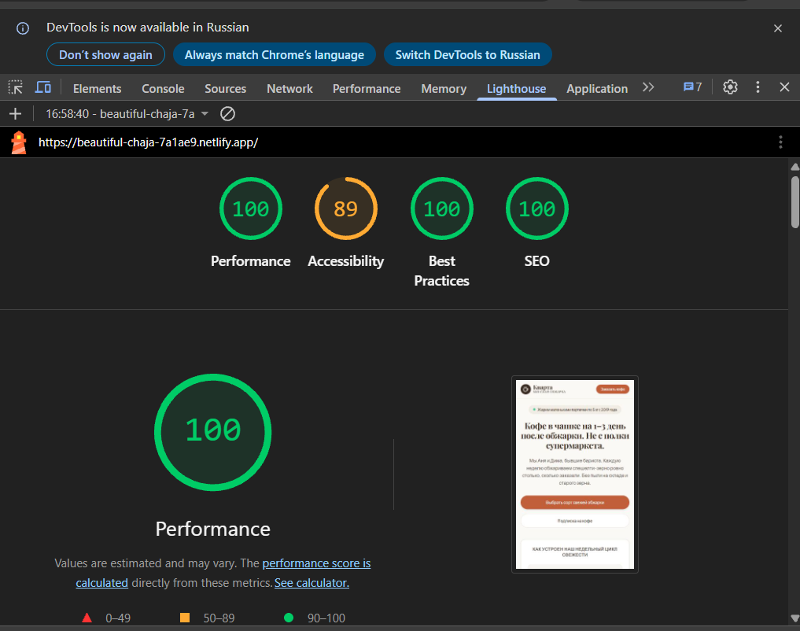

Вероятно получилось однотипно, ну и ладно.

**Живой сайт:** [https://beautiful-chaja-7a1ae9.netlify.app/](https://beautiful-chaja-7a1ae9.netlify.app/)
**Репозиторий:** [https://github.com/Bel4our/kvarta-coffee](https://github.com/Bel4our/kvarta-coffee)
**Стек:** Next.js (App Router, Server & Client Components), TypeScript, Tailwind CSS, Lucide Icons. Деплой — Netlify

---

Замер производительности Lighthouse (Mobile)
Замер проведён для мобильной версии в Google Chrome DevTools:

**Performance:** 100
**Accessibility:** 89
**Best Practices:** 100
**SEO:** 100

---
   Обработка формы реализована через встроенный Route Handler `POST /api/lead`.
   В serverless-среде хостинга (Netlify/Vercel) файловая система является ephemeral (read-only во время рантайма функций). Поэтому для защиты от дабл-клика и повторных заявок реализован серверный in-memory кэш по  номеру телефона
   При повторной отправке в течение 10 минут сервер возвращает статус `429 Too Many Requests` с указанием минут до окончания блокировки Локально для разработки данные персистентно сохраняются в `leads.json`.
   При загрузке страницы скрипт перехватывает параметры `utm_source`, `utm_medium`, `utm_campaign`, `utm_content`, `utm_term`, а также `document.referrer` и `page_url`. Они прикрепляются к телу заявки для понимания менеджером источника перехода.
   В эндпоинт заложена отправка лида в Telegram-чат через Telegram Bot API при передаче `TELEGRAM_BOT_TOKEN` и `TELEGRAM_CHAT_ID`, однако самого телеграм бота нет)).
---

## Ошибки ИИ (Gemini Flash 3.8)
   Скриншоты с ии имеются, однако не очень информативные, ошибки находились при проверке кода написанного ии.
   В целом структуру он сделал хорошую  исходя из моих требований однако были некоторые косяки:
   Застревание каретки в маске ввода телефона: при удалении символов клавишей Backspace курсор упирался в знаки маски (скобки, дефисы), маска дублировала префикс `+375`, а каретка перескакивала в конец строки
   ИИ использовал динамический `new Date().getFullYear()` в серверном компоненте подвала, что привело к падению билда на Netlify. Это не критично но было исправлено
   Кроме того было много проблем с адаптивом, которые были пофикшены (кривые отступы и в целом отстутствие адаптива на некоторых элементах).
   Также использовал стандартные инструменты по типу обычных некрасивых выпдающих списков
   Однако после внесения правок без проблем справлялся с ошибками.  

---

##  Мои правки, недочёты и предложения
Добавил ссылки на адрес места, перенаправляющие в Яндекс Карты.
Возможно стоило подключить Supabase Postgres через Prisma/Drizzle с миграциями
Сделать добавление аккуратных микровзаимодействий при добавлении сорта кофе в корзину заказа.
Добавить отдельный вывод инфы для карточки товара
Кроме того если бы было больше информации про "владельцев",можно более оригинально переиграть дизайн всего проекта, хотя минимализм есть минимализм
Также можно было бы добавить защиту от перегрузок и атак(хотя возможно это не целесообразно)
Внешний вид мобильной версии, конечно, оставляет желать лучшего и как я думаю остались моменты с ошибками адаптивного дизайна, однако в целом я думаю даже такой вариант в целом может выполнить свою задачу.